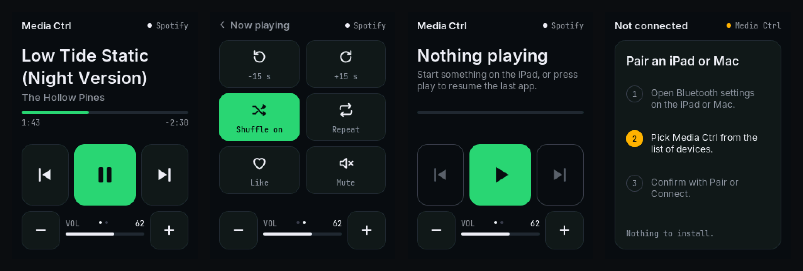

# Media Ctrl: a desk media remote for the iPad on the Cheap Yellow Display

_An open-hardware project from [WOODWERD LLC](https://woodwerd.com), a design group in Austin, Texas._

Media Ctrl turns the ESP32-2432S028R "Cheap Yellow Display" (CYD) into a small media remote that stands beside your keyboard, in portrait. It pairs with an **iPad** over Bluetooth, shows what is playing, and controls it. The iPad needs no app.

- **Now playing:** app name, track title, artist, a live progress bar with elapsed and remaining time, and the iPad's volume.
- **Transport:** large previous, play/pause and next buttons, plus volume − and +.
- **More** (swipe left): skip back and forward, shuffle, repeat, like and mute.
- **Works with any app that shows in Control Center,** such as Spotify, Apple Music, Podcasts and YouTube.



**New here?** Start with [Getting started](docs/GETTING_STARTED.md), then [Flash it](docs/flash/index.md).

> Unofficial. Not affiliated with or endorsed by Apple or Spotify. See [THIRD_PARTY_NOTICES.md](THIRD_PARTY_NOTICES.md).

## How it works

A single Bluetooth LE link to the iPad does two jobs:

1. **Media keys.** The board is a Bluetooth HID device that sends only the standard media keys (Consumer Control page): play/pause, next, previous, volume and mute. Every computer and tablet understands these. The HID descriptor has no keyboard collection, so the iPad keeps its on-screen keyboard.
2. **Apple Media Service (AMS).** iPadOS and iOS publish the system's Now Playing state to paired Bluetooth accessories through AMS, the same channel an Apple Watch uses. The board subscribes to it to read the app, title, artist, duration, elapsed time, volume, shuffle and repeat. It also sends AMS remote commands, including skip ±, like, shuffle and repeat, which have no media-key equivalent.

When AMS is present, the board uses it for everything AMS can do. When it isn't, the media keys are the fallback and the screen says so.

| On the screen | iPad (AMS) | Without AMS (media keys) |
|---|---|---|
| Title, artist, progress, volume | ✓ | — |
| Previous / Play-Pause / Next | ✓ | ✓ |
| Volume − / + | ✓ (the number follows the iPad) | ✓ |
| −15 s / +15 s, shuffle, repeat, like | ✓ if the app supports it (tiles dim if not) | — |
| Mute | media key | media key |

### iPad, Mac and the rest

| Host | What you get |
|---|---|
| iPad, iPhone | Everything above. |
| Mac | Media keys only. macOS does not publish Apple Media Service to accessories, so the screen shows **Connected · keys only**. A Mac build with a small helper app over USB is planned. |
| Windows, Android | Media keys only (untested). |

The board connects to one host at a time and remembers several. To add a second device, long-press the title and choose **Pair another device**. That releases the current host for a minute so the new one can pair.

## Quick start (no toolchain)

1. **Flash** `release/media-ctrl-v0.1.1-cyd2usb.bin` at address **0x0**, either:
   - from the [Flash it](docs/flash/index.md) page in Chrome or Edge, or
   - in a terminal, after `pip install esptool`:
     ```
     esptool.py --chip esp32 --port /dev/cu.usbserial-XXXX --baud 460800 write_flash 0x0 media-ctrl-v0.1.1-cyd2usb.bin
     ```
   If the port doesn't appear, hold **BOOT** while plugging the board in. 921600 baud is unreliable on the CH340.
2. **Pair.** On the iPad, open Settings › Bluetooth, tap **Media Ctrl**, then tap **Pair**.
3. **Play something.** Within a couple of seconds the screen fills in.

The full image starts with a clean pairing table each time it's flashed. To update without losing pairings, write `release/media-ctrl-v0.1.1-cyd2usb-app-0x10000.bin` at **0x10000** instead.

## Hardware

- **ESP32-2432S028R CYD, USB-C / "2-USB" variant (ST7789 panel).** This is the prebuilt image.
- **Original micro-USB CYD (ILI9341).** Build the `cyd` environment (untested).
- **Power:** USB from the iPad's charger, a hub or the Mac. The backlight dims after two minutes untouched and never turns off; a touch or a new track wakes it.

Nothing to solder. Any CYD case that leaves the screen exposed works, held in portrait.

## Docs

- [Getting started](docs/GETTING_STARTED.md): pairing, every screen and button, About and troubleshooting.
- [Flash it](docs/flash/index.md): browser flasher and terminal commands.
- [Firmware & code](docs/firmware.md): building, build flags, how the Bluetooth layer works, the host simulator.
- [Bench test](docs/TESTING.md): the checklist used before each release.
- [Changelog](CHANGELOG.md).

## License

MIT © 2026 WOODWERD LLC. See [LICENSE](LICENSE) and [THIRD_PARTY_NOTICES.md](THIRD_PARTY_NOTICES.md) for the libraries and fonts it builds on.
