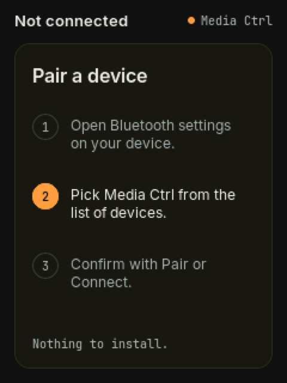
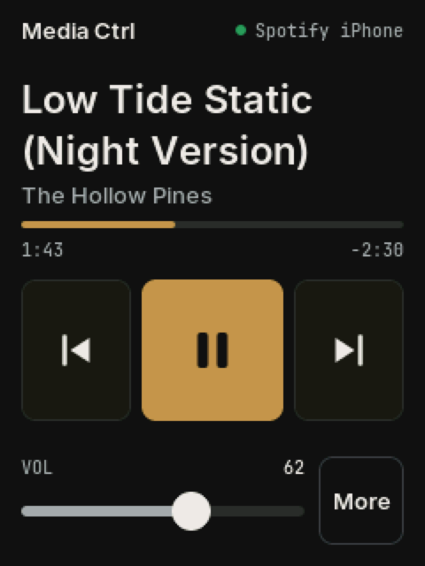
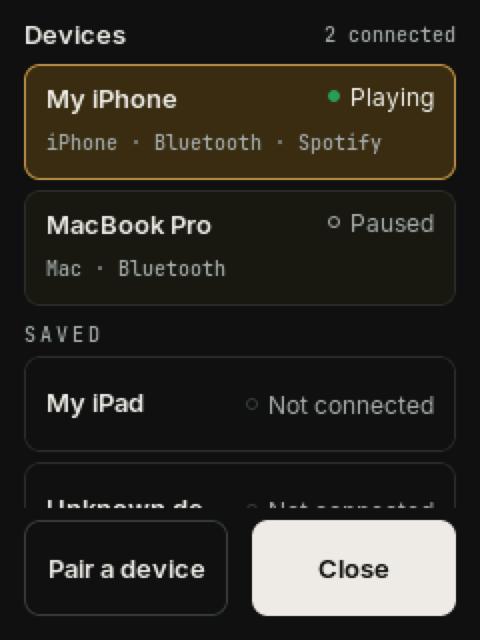
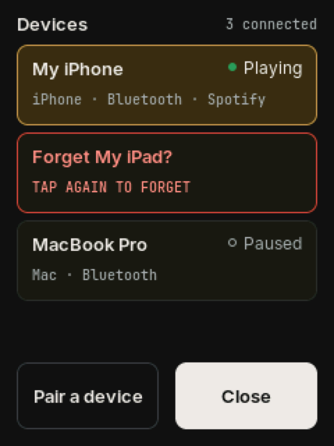
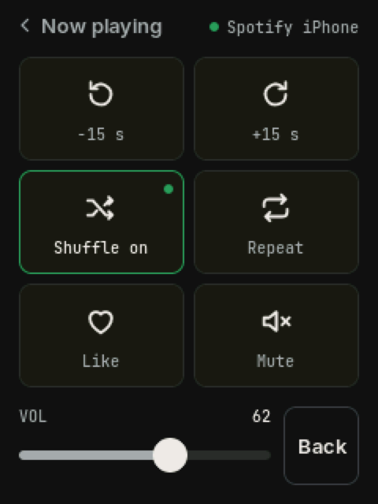
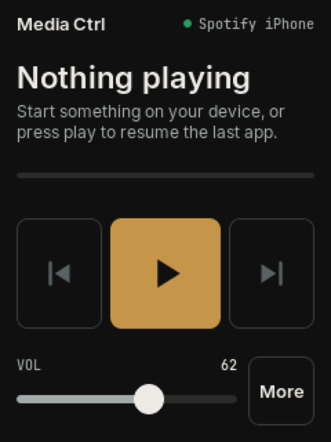
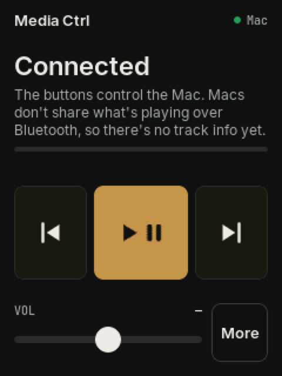
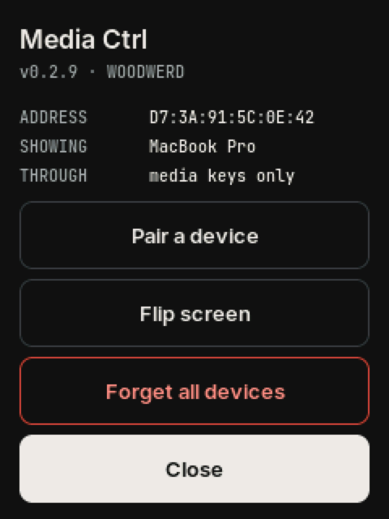

# Getting started

Media Ctrl connects over Bluetooth to up to three devices at once, such as an iPhone, an iPad and a Mac. It shows what's playing on one of them and controls it. The USB cable only powers the board and lets you flash it.

## 1. Pair

When the board has no device, it shows **Not connected** with an amber dot and walks you through pairing. The step you're on is highlighted.

**iPhone or iPad**

1. Open **Settings › Bluetooth**.
2. Tap **Media Ctrl** under Other Devices.
3. Tap **Pair** when asked.

**Mac**

1. Open **System Settings › Bluetooth**.
2. Find **Media Ctrl** in the list of nearby devices and click **Connect**. macOS lists it as a keyboard-type accessory. That's expected, and it doesn't take over your keyboard.

**A second or third device.** Pair it the same way. The board stays visible to new devices until three are connected. With three connected, hold the top right of the screen to open **Devices** and tap **Pair a device**. That opens pairing for one minute and lets go of one device the board isn't showing.

The board remembers each device and reconnects on its own after power-up.

## 2. Now playing

| Element | What it does |
|---|---|
| Top right | The app and the device it's playing on, such as **Spotify iPhone** or **YouTube iPad**. A green dot means connected. Hold it to open [Devices](#3-devices-switching-between-them). |
| Title, artist | The current track. Long titles take two lines; long artist names end in "…". |
| Progress bar | Elapsed time on the left, remaining time on the right. The board counts it forward between updates. |
| ⏮ | Previous track, or back to the start of the track (the app decides). |
| ▶ / ❚❚ | Play or pause. The icon follows the device's real state. |
| ⏭ | Next track. |
| Volume slider | Drag to set the volume. On an iPhone or iPad the board steps the volume towards where you let go, and the number follows the device, including changes made on it. |
| More | Opens the second page. |

## 3. Devices: switching between them

**Hold the top right of the screen**, where the app and device name show, to open **Devices**.

- **Connected devices** are listed first, each with what it's playing. The one the board is showing has an amber outline.
- **Tap a device** to show and control it. The board confirms with "Switched to …".
- **Saved** lists devices the board has paired with that are off or out of range.
- **Pair a device** adds another one (see [Pair](#1-pair)).

**The board follows you.** Whenever a different device starts playing, the board moves to it. Pausing never moves it, so play resumes the device you just paused. Tapping a device in this list chooses it until another one starts playing.

## 4. Forgetting a device

To remove one device without disturbing the others:

1. Open **Devices** and **hold that device's row** until it turns red and reads **Forget …?**
2. **Tap it again** within 4 seconds. Waiting, or tapping anywhere else, cancels.
3. On that device, also remove Media Ctrl: **Settings › Bluetooth › ⓘ › Forget This Device** on an iPhone or iPad, or System Settings › Bluetooth on a Mac. The board reminds you.

Every other device stays paired and connected. To pair the forgotten device again, use **Pair a device**.

To remove everything at once, use **Forget all devices** in [About](#8-about-long-press-the-title).

## 5. More

Tap **More** to open it, and **‹ Now playing** or **Back** to return. Swiping left and right also works.

| Tile | What it does |
|---|---|
| −15 s / +15 s | Skip within the track. The app sets the real interval, usually 15 s for podcasts and audiobooks. |
| Shuffle | Cycles the app's shuffle mode. Green means on. |
| Repeat | Cycles off, all and one. Green means on; the label shows which mode. |
| Like | Likes the current track, in apps that support it. |
| Mute | Sends the mute media key. |

Tiles the current app or device doesn't support are dimmed.

## 6. When nothing is playing

Play still works. It resumes whatever app last played. Previous and next are disabled until something is loaded.

## 7. A Mac: buttons only

A Mac doesn't share what's playing with Bluetooth accessories, so on a Mac the board can't show the track. The top right reads **Mac** and the screen says so. The buttons still work:

| | On a Mac |
|---|---|
| Play/pause | ✓. The button shows play and pause together, because the Mac doesn't say which state it's in. |
| Previous, next | ✓ in apps with a queue, such as Spotify and Music. YouTube skips only within a playlist. |
| Volume | ✓ in steps. |
| Track, progress, More tiles | Not yet. |

The Mac sends the buttons to **whichever app played last**. Start a video in the browser and the buttons control it; start Spotify and they move back to Spotify.

Track info for the Mac, and for Windows, comes with a helper app that talks to the board over Bluetooth. It's planned. See [Media Ctrl on a Mac](MAC.md).

An iPhone or iPad that hasn't shared what's playing yet shows the same screen for a short while after connecting.

## 8. About (long-press the title)

- **Address / Showing / Through:** the board's Bluetooth address, the device it's showing, and how: Apple Media Service for an iPhone or iPad, or media keys only.
- **Pair a device:** the same as in Devices.
- **Flip screen:** rotates the display 180° to suit how you stand the board. The setting is remembered.
- **Forget all devices:** tap twice. This removes every pairing and gives the board a new Bluetooth address, so devices see it as new. Also remove Media Ctrl on each device.
- **Close.**

## Troubleshooting

| Symptom | Fix |
|---|---|
| Can't find the Devices list | Hold the top right of the screen, where the app and device show, for about half a second. |
| A new device doesn't see Media Ctrl | Three devices are already connected. Open Devices and tap **Pair a device**, then look again within a minute. |
| A device lists Media Ctrl but won't connect | It has an old pairing the board no longer has. Forget Media Ctrl on that device and pair again. |
| The board stays on the wrong device | It follows the device that started playing most recently. Hold the top right and tap the one you want. |
| Next does nothing on the Mac | The Mac sends it to the app that played last, and that app may have nothing to skip to, such as a single YouTube video. |
| Title never appears on an iPhone or iPad | Play something for a few seconds; the board keeps asking for about a minute after connecting. If it never appears, forget the device on both sides and pair again. |
| Taps land in the wrong place | Use **Flip screen**. If touch is still mirrored, see [Firmware & code](firmware.md) for `-DTOUCH_DEBUG`. |
| Screen dim | It dims after two minutes. Touch it, or change track. |

The serial monitor (115200 baud) logs `[ble]`, `[ams]` and `[hid]` events, plus a `#alive` heartbeat every 5 s.
