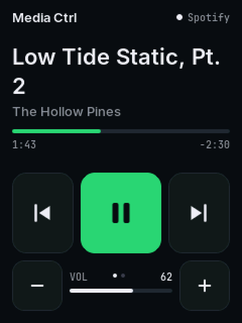

# Media Ctrl on a Mac

On an iPad, Media Ctrl reads Now Playing over Bluetooth by itself. macOS doesn't publish that to accessories, so on a Mac a small helper app supplies it instead. It talks to the board over the **USB cable** the board is powered from, and drives **Spotify** and **Apple Music** directly.



## What you get

| | With the helper | Without it (Bluetooth media keys only) |
|---|---|---|
| App, title, artist, progress | ✓ Spotify, Music | — |
| Play/pause, previous, next | ✓ | ✓ |
| Volume − / + and the volume number | ✓ (system volume) | keys only, no number |
| Mute | ✓ | ✓ |
| −15 s / +15 s, shuffle, repeat | ✓ | — |
| Like | Music only (Spotify doesn't allow it from scripts) | — |

A video playing in a browser tab doesn't report to the helper. The board's Bluetooth media keys still control it.

## Install

You need the board on a USB cable to the Mac, running firmware **v0.2.0 or later**.

1. Download or clone this repository, open Terminal in the `mac-helper` folder, and run:
   ```
   ./install.sh
   ```
   This copies the helper to `~/Library/Application Support/MediaCtrl` and starts it now and at every login. It uses the Mac's built-in Python 3. If that isn't set up yet, macOS offers to install the Command Line Tools; accept, then run `./install.sh` again.
2. Play something in Spotify or Music. The first time, macOS asks whether **python3** may control that app. Click **OK**. You can change this later in System Settings › Privacy & Security › Automation.
3. Within a couple of seconds the board shows the track, with the app name top right.

To check it from Terminal before installing:

```
python3 media_ctrl_helper.py --once     # prints what it would send to the board
python3 media_ctrl_helper.py            # runs in the foreground; Ctrl-C to stop
```

## Day to day

- **Flashing the board:** the helper holds the USB port. Run `./stop.sh` first, flash with ESP Ctrl, then `./start.sh`. `stop.sh` also lasts until your next login.
- **Log:** `~/Library/Logs/MediaCtrl.log` records when the board is found and lost, and each command.
- **Remove:** `./uninstall.sh`.
- **iPad and Mac together:** the board pairs with the iPad over Bluetooth and listens to the Mac over USB at the same time. Whichever one is playing is shown; when neither is, the Mac wins.

## How it works

- **Finding the board.** The helper asks every USB serial port `{"t":"who"}`. Only Media Ctrl answers. Ports are opened with DTR and RTS held low, so the board isn't reset. A Flow Ctrl or any other device on USB is left alone.
- **Reading.** Once a second it reads Spotify and Music with AppleScript. It only reads apps that are already running, so it never launches one just to look. It also reads the system output volume and mute. When something changes, and at least every 4 s, it sends one JSON line.
- **Buttons.** The board sends `{"t":"cmd","c":N}`. The helper runs the matching AppleScript (`playpause`, `next track`, `set player position`, shuffle and repeat) or changes the system volume, then reports the new state at once.
- **Board side.** If the helper goes quiet for 8 s, the board falls back to Bluetooth (iPad, or media keys).

The full message format is documented at the top of `src/host_link.h`.

## Files

| File | |
|---|---|
| `mac-helper/media_ctrl_helper.py` | The helper. One file, standard library plus the bundled pyserial. |
| `mac-helper/serial/` | [pyserial](https://github.com/pyserial/pyserial) 3.5 (BSD-3-Clause), trimmed to the macOS/POSIX parts |
| `mac-helper/install.sh`, `uninstall.sh`, `start.sh`, `stop.sh` | LaunchAgent `com.woodwerd.mediactrl` |
| `mac-helper/tests/test_helper.py` | Runs anywhere: a fake Mac, plus a fake board on a pseudo-terminal |
